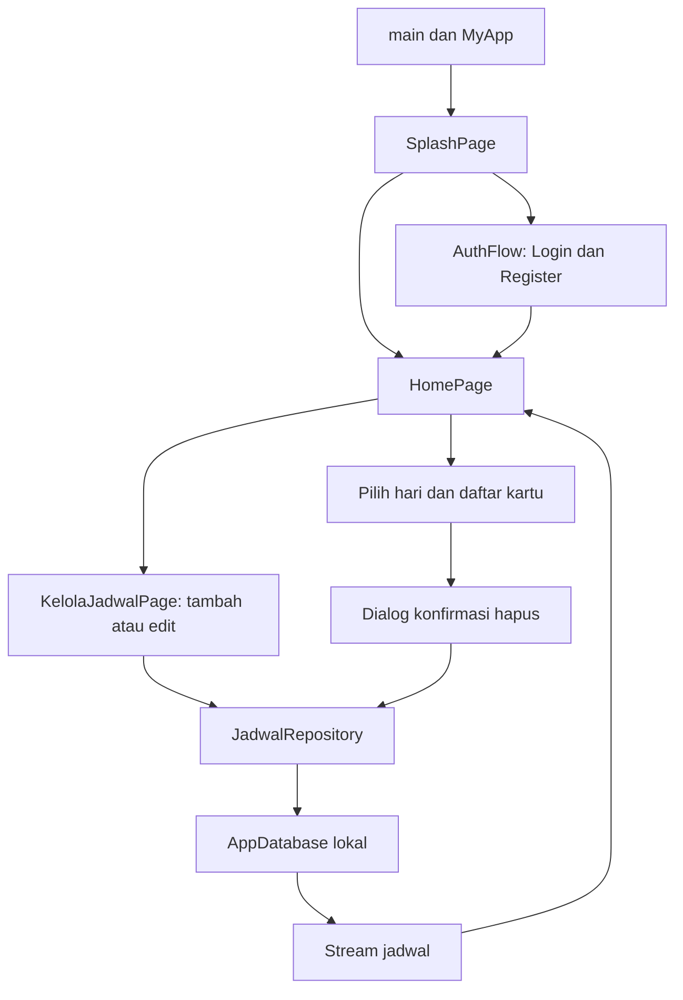

# Panduan belajar UI Jadwalin

Panduan ini membaca kode proyek pada **21 Oktober 2026**. Ditulis untuk belajar dari dasar: kode lengkap tiap file ditampilkan dahulu, kemudian perannya, class/widget/properti penting, cara kerja, dan alasan pemakaian dibahas dalam konteks aplikasi.

## Mulai belajar

| Urutan | Bab | Yang dipelajari |
|---|---|---|
| 1 | [Dasar Flutter dan Dart](00-dasar.md) | Widget tree, class, state, build, layout, callback, async, dan sintaks Dart. |
| 2 | [Fondasi aplikasi dan tema](01-fondasi-aplikasi.md) | main, MyApp, dependency, MaterialApp, navigasi awal, dan AppColors. |
| 3 | [Home dan kartu jadwal](02-home.md) | 16 file: daftar, pilihan hari, kartu, detail, pengingat, menu, dan dialog. |
| 4 | [Splash dan autentikasi](03-autentikasi-splash.md) | 12 file: animasi, loading/error/retry, login, registrasi, dan komponen form akun. |
| 5 | [Tambah dan edit jadwal](04-form-jadwal.md) | 12 file: input, validasi, waktu, reminder, save, dan konfirmasi perubahan. |
| Referensi | [Glosarium](05-glosarium.md) | Arti widget, objek gaya, controller, properti, method, dan istilah. |
| Pendukung | [Helper, data, dan service](06-pendukung-ui.md) | Format waktu/hari, database/repository, bootstrap, simulasi akun, dan pengingat lokal. |
| Konfigurasi | [Package, font, dan aset](07-package-font-aset.md) | Pubspec, package, font Inter/Merriweather Sans, PNG/SVG, dan resource web. |

Untuk tab IDE yang sedang kamu pelajari, mulai dari bagian `KartuJadwal` pada bab Home, lalu ikuti `JadwalCardHeader` → `JadwalCardDetails` → `JadwalCardReminder`. Setelah itu baca `HariBubble` dan dialog hapus.

## Ringkasan yang dipakai proyek

- **Bahasa dan UI:** Dart, Flutter, dan komponen Material 3.
- **Penyusunan tampilan:** widget kecil yang dirangkai halaman, Row/Column, flex, padding, constraint, scroll, dan layout responsif.
- **State/interaksi:** State/setState, constructor, callback, controller, key, dan StreamBuilder untuk perubahan jadwal.
- **Gaya/aset:** AppColors, tema lokal/global, Inter, Merriweather Sans, PNG, dan SVG melalui flutter_svg.
- **Input/navigasi:** Form, validator, dropdown, time picker, Navigator, dialog konfirmasi, SnackBar, dan PopScope.
- **Animasi:** AnimationController, AnimatedBuilder, ticker, serta custom clipping gelombang pada splash.
- **Data yang memberi isi UI:** Drift lokal, repository, helper hari/waktu, bootstrapper, dan service pengingat.

**Cara membedakan nama:** `IntrinsicHeight` adalah widget layout; `TextStyle` adalah konfigurasi gaya; `TextEditingController` mengelola input; `JadwalRepository` mengelola operasi data. Semua class itu punya peran berbeda.

## Cakupan dan cara membaca

Inventaris menemukan **51 file Dart dalam lib**: **42 file UI** dan **9 file pendukung**. Seluruh 42 file UI dibahas. Kode lengkap juga disertakan untuk 7 file pendukung yang berisi kode manual. `api_service.dart` masih kosong; `database.g.dart` adalah keluaran generator dan dijelaskan peran/modelnya tanpa menyalin seluruh keluaran generator.

Dengan demikian, **49 file Dart berisi kode dilampirkan lengkap**, ditambah pubspec. Semua file Dart lib mendapat tempat dalam peta belajar. Berkas binary aset, keluaran generator, test, dan wrapper platform dipetakan seperlunya untuk memahami UI.

Pada setiap bagian, “alasan pemakaian” menjelaskan manfaat yang terlihat dari struktur dan perilaku kode. Jika merupakan penafsiran, itu bukan pernyataan pasti mengenai niat awal penulis atau kecocokan dengan desain Figma.

Salinan kode adalah snapshot, bukan file yang dijalankan aplikasi. Komentar `SUMBER` sebelum blok kode mencatat path asal dan SHA-256 byte sumber saat penyalinan. Untuk perubahan setelah tanggal pembacaan, gunakan tautan **Buka sumber** untuk melihat file aplikasi terbaru.

## Peta alur

Panah splash ke Home adalah cabang yang disediakan hasil bootstrap. Wiring default main masih memakai pemeriksa sesi dan offline yang mengembalikan false. Lihat bab fondasi untuk membedakan jalur yang tersedia dari integrasi yang sudah nyata.

## Inventaris file

Tabel ini menghubungkan setiap file Dart dengan deklarasi miliknya dan bab penjelasan. Klik nama file untuk membuka sumber; klik bab untuk menuju pembahasannya.

| File sumber | Deklarasi utama | Pembahasan |
|---|---|---|
| [lib/database/database.dart](../../lib/database/database.dart) | `MataKuliahTable`, `JadwalKuliahTable`, `JadwalDenganMataKuliah`, `AppDatabase` | [Buka bab](06-pendukung-ui.md#file-lib-database-database-dart) |
| [lib/database/database.g.dart](../../lib/database/database.g.dart) | Model/companion dan infrastruktur Drift generated | [Buka bab](06-pendukung-ui.md#file-lib-database-database-g-dart) |
| [lib/main.dart](../../lib/main.dart) | `main`, `MyApp`, `_MyAppState` | [Buka bab](01-fondasi-aplikasi.md#file-lib-main-dart) |
| [lib/pages/auth/auth_flow.dart](../../lib/pages/auth/auth_flow.dart) | `AuthFlow` | [Buka bab](03-autentikasi-splash.md#file-lib-pages-auth-auth-flow-dart) |
| [lib/pages/auth/auth_page_layout.dart](../../lib/pages/auth/auth_page_layout.dart) | `AuthPageLayout` | [Buka bab](03-autentikasi-splash.md#file-lib-pages-auth-auth-page-layout-dart) |
| [lib/pages/auth/auth_prompt.dart](../../lib/pages/auth/auth_prompt.dart) | `AuthPrompt` | [Buka bab](03-autentikasi-splash.md#file-lib-pages-auth-auth-prompt-dart) |
| [lib/pages/auth/login_page.dart](../../lib/pages/auth/login_page.dart) | `LoginPage`, `_LoginPageState` | [Buka bab](03-autentikasi-splash.md#file-lib-pages-auth-login-page-dart) |
| [lib/pages/auth/register_page.dart](../../lib/pages/auth/register_page.dart) | `RegisterPage`, `_RegisterPageState` | [Buka bab](03-autentikasi-splash.md#file-lib-pages-auth-register-page-dart) |
| [lib/pages/auth/widgets/auth_header.dart](../../lib/pages/auth/widgets/auth_header.dart) | `AuthHeader` | [Buka bab](03-autentikasi-splash.md#file-lib-pages-auth-widgets-auth-header-dart) |
| [lib/pages/auth/widgets/auth_submit_button.dart](../../lib/pages/auth/widgets/auth_submit_button.dart) | `AuthSubmitButton`, `AuthSubmitError` | [Buka bab](03-autentikasi-splash.md#file-lib-pages-auth-widgets-auth-submit-button-dart) |
| [lib/pages/auth/widgets/login_fields.dart](../../lib/pages/auth/widgets/login_fields.dart) | `LoginFields` | [Buka bab](03-autentikasi-splash.md#file-lib-pages-auth-widgets-login-fields-dart) |
| [lib/pages/auth/widgets/register_fields.dart](../../lib/pages/auth/widgets/register_fields.dart) | `RegisterFields` | [Buka bab](03-autentikasi-splash.md#file-lib-pages-auth-widgets-register-fields-dart) |
| [lib/pages/home/home.dart](../../lib/pages/home/home.dart) | `HomePage`, `_HomePageState` | [Buka bab](02-home.md#file-lib-pages-home-home-dart) |
| [lib/pages/home/widgets/hapus_jadwal_dialog.dart](../../lib/pages/home/widgets/hapus_jadwal_dialog.dart) | `HapusJadwalDialog` | [Buka bab](02-home.md#file-lib-pages-home-widgets-hapus-jadwal-dialog-dart) |
| [lib/pages/home/widgets/hari_bubble.dart](../../lib/pages/home/widgets/hari_bubble.dart) | `HariBubble` | [Buka bab](02-home.md#file-lib-pages-home-widgets-hari-bubble-dart) |
| [lib/pages/home/widgets/home_day_summary.dart](../../lib/pages/home/widgets/home_day_summary.dart) | `HomeDaySummary` | [Buka bab](02-home.md#file-lib-pages-home-widgets-home-day-summary-dart) |
| [lib/pages/home/widgets/home_header.dart](../../lib/pages/home/widgets/home_header.dart) | `HomeHeader` | [Buka bab](02-home.md#file-lib-pages-home-widgets-home-header-dart) |
| [lib/pages/home/widgets/home_icon.dart](../../lib/pages/home/widgets/home_icon.dart) | `HomeIcon` | [Buka bab](02-home.md#file-lib-pages-home-widgets-home-icon-dart) |
| [lib/pages/home/widgets/jadwal_card_details.dart](../../lib/pages/home/widgets/jadwal_card_details.dart) | `JadwalCardDetails`, `_InfoDetail` | [Buka bab](02-home.md#file-lib-pages-home-widgets-jadwal-card-details-dart) |
| [lib/pages/home/widgets/jadwal_card_header.dart](../../lib/pages/home/widgets/jadwal_card_header.dart) | `JadwalCardHeader` | [Buka bab](02-home.md#file-lib-pages-home-widgets-jadwal-card-header-dart) |
| [lib/pages/home/widgets/jadwal_card_reminder.dart](../../lib/pages/home/widgets/jadwal_card_reminder.dart) | `JadwalCardReminder` | [Buka bab](02-home.md#file-lib-pages-home-widgets-jadwal-card-reminder-dart) |
| [lib/pages/home/widgets/jadwal_kosong.dart](../../lib/pages/home/widgets/jadwal_kosong.dart) | `JadwalKosong` | [Buka bab](02-home.md#file-lib-pages-home-widgets-jadwal-kosong-dart) |
| [lib/pages/home/widgets/kartu_jadwal.dart](../../lib/pages/home/widgets/kartu_jadwal.dart) | `KartuJadwal` | [Buka bab](02-home.md#file-lib-pages-home-widgets-kartu-jadwal-dart) |
| [lib/pages/home/widgets/list_jadwal.dart](../../lib/pages/home/widgets/list_jadwal.dart) | `ListJadwal` | [Buka bab](02-home.md#file-lib-pages-home-widgets-list-jadwal-dart) |
| [lib/pages/home/widgets/menu_akun_button.dart](../../lib/pages/home/widgets/menu_akun_button.dart) | `_AksiAkun`, `MenuAkunButton`, `_MenuAkunButtonState` | [Buka bab](02-home.md#file-lib-pages-home-widgets-menu-akun-button-dart) |
| [lib/pages/home/widgets/pilih_hari.dart](../../lib/pages/home/widgets/pilih_hari.dart) | `PilihHari`, `_PilihHariState` | [Buka bab](02-home.md#file-lib-pages-home-widgets-pilih-hari-dart) |
| [lib/pages/home/widgets/status_jadwal.dart](../../lib/pages/home/widgets/status_jadwal.dart) | `JadwalLoadError`, `JadwalLoading` | [Buka bab](02-home.md#file-lib-pages-home-widgets-status-jadwal-dart) |
| [lib/pages/home/widgets/tambah_jadwal_button.dart](../../lib/pages/home/widgets/tambah_jadwal_button.dart) | `TambahJadwalButton` | [Buka bab](02-home.md#file-lib-pages-home-widgets-tambah-jadwal-button-dart) |
| [lib/pages/jadwal/kelola_jadwal.dart](../../lib/pages/jadwal/kelola_jadwal.dart) | `KelolaJadwalPage`, `_KelolaJadwalPageState` | [Buka bab](04-form-jadwal.md#file-lib-pages-jadwal-kelola-jadwal-dart) |
| [lib/pages/jadwal/widgets/buang_perubahan_dialog.dart](../../lib/pages/jadwal/widgets/buang_perubahan_dialog.dart) | `BuangPerubahanDialog` | [Buka bab](04-form-jadwal.md#file-lib-pages-jadwal-widgets-buang-perubahan-dialog-dart) |
| [lib/pages/jadwal/widgets/jadwal_app_bar.dart](../../lib/pages/jadwal/widgets/jadwal_app_bar.dart) | `JadwalAppBar` | [Buka bab](04-form-jadwal.md#file-lib-pages-jadwal-widgets-jadwal-app-bar-dart) |
| [lib/pages/jadwal/widgets/jadwal_form_footer.dart](../../lib/pages/jadwal/widgets/jadwal_form_footer.dart) | `JadwalFormFooter` | [Buka bab](04-form-jadwal.md#file-lib-pages-jadwal-widgets-jadwal-form-footer-dart) |
| [lib/pages/jadwal/widgets/jadwal_form_layout.dart](../../lib/pages/jadwal/widgets/jadwal_form_layout.dart) | `JadwalFormLayout` | [Buka bab](04-form-jadwal.md#file-lib-pages-jadwal-widgets-jadwal-form-layout-dart) |
| [lib/pages/jadwal/widgets/jadwal_form_style.dart](../../lib/pages/jadwal/widgets/jadwal_form_style.dart) | `jadwalFormTheme`, `JadwalFormIcon`, `JadwalField`, `JadwalSection` | [Buka bab](04-form-jadwal.md#file-lib-pages-jadwal-widgets-jadwal-form-style-dart) |
| [lib/pages/jadwal/widgets/jadwal_time_picker_frame.dart](../../lib/pages/jadwal/widgets/jadwal_time_picker_frame.dart) | `JadwalTimePickerFrame` | [Buka bab](04-form-jadwal.md#file-lib-pages-jadwal-widgets-jadwal-time-picker-frame-dart) |
| [lib/pages/jadwal/widgets/jam_kuliah_field.dart](../../lib/pages/jadwal/widgets/jam_kuliah_field.dart) | `JamKuliahField` | [Buka bab](04-form-jadwal.md#file-lib-pages-jadwal-widgets-jam-kuliah-field-dart) |
| [lib/pages/jadwal/widgets/mata_kuliah_form.dart](../../lib/pages/jadwal/widgets/mata_kuliah_form.dart) | `MataKuliahForm` | [Buka bab](04-form-jadwal.md#file-lib-pages-jadwal-widgets-mata-kuliah-form-dart) |
| [lib/pages/jadwal/widgets/pengingat_form.dart](../../lib/pages/jadwal/widgets/pengingat_form.dart) | `PengingatForm` | [Buka bab](04-form-jadwal.md#file-lib-pages-jadwal-widgets-pengingat-form-dart) |
| [lib/pages/jadwal/widgets/simpan_jadwal_button.dart](../../lib/pages/jadwal/widgets/simpan_jadwal_button.dart) | `SimpanJadwalButton` | [Buka bab](04-form-jadwal.md#file-lib-pages-jadwal-widgets-simpan-jadwal-button-dart) |
| [lib/pages/jadwal/widgets/waktu_kuliah_form.dart](../../lib/pages/jadwal/widgets/waktu_kuliah_form.dart) | `WaktuKuliahForm` | [Buka bab](04-form-jadwal.md#file-lib-pages-jadwal-widgets-waktu-kuliah-form-dart) |
| [lib/pages/splash/splash_page.dart](../../lib/pages/splash/splash_page.dart) | `SplashLoader`, `SplashDestinationBuilder`, `SplashPage`, `_SplashPageState` | [Buka bab](03-autentikasi-splash.md#file-lib-pages-splash-splash-page-dart) |
| [lib/pages/splash/widgets/liquid_logo.dart](../../lib/pages/splash/widgets/liquid_logo.dart) | `LiquidLogo`, `_LiquidLogoState`, `_LogoWaveClipper` | [Buka bab](03-autentikasi-splash.md#file-lib-pages-splash-widgets-liquid-logo-dart) |
| [lib/pages/splash/widgets/splash_error.dart](../../lib/pages/splash/widgets/splash_error.dart) | `SplashError` | [Buka bab](03-autentikasi-splash.md#file-lib-pages-splash-widgets-splash-error-dart) |
| [lib/repositories/jadwal_repository.dart](../../lib/repositories/jadwal_repository.dart) | `JadwalDraft`, `JadwalRepository` | [Buka bab](06-pendukung-ui.md#file-lib-repositories-jadwal-repository-dart) |
| [lib/services/api_service.dart](../../lib/services/api_service.dart) | Kosong; belum ada deklarasi | [Buka bab](06-pendukung-ui.md#file-lib-services-api-service-dart) |
| [lib/services/app_bootstrapper.dart](../../lib/services/app_bootstrapper.dart) | `BootstrapProgressCallback`, `AppLaunchDestination`, `AppBootstrapResult`, `AppBootstrapper`, `DefaultAppBootstrapper` | [Buka bab](06-pendukung-ui.md#file-lib-services-app-bootstrapper-dart) |
| [lib/services/auth_gateway.dart](../../lib/services/auth_gateway.dart) | `AuthGateway`, `SimulatedAuthGateway` | [Buka bab](06-pendukung-ui.md#file-lib-services-auth-gateway-dart) |
| [lib/services/notification_service.dart](../../lib/services/notification_service.dart) | `NotificationService` | [Buka bab](06-pendukung-ui.md#file-lib-services-notification-service-dart) |
| [lib/theme/app_colors.dart](../../lib/theme/app_colors.dart) | `AppColors` | [Buka bab](01-fondasi-aplikasi.md#file-lib-theme-app-colors-dart) |
| [lib/utils/day_helper.dart](../../lib/utils/day_helper.dart) | `DayHelper` | [Buka bab](06-pendukung-ui.md#file-lib-utils-day-helper-dart) |
| [lib/utils/time_helper.dart](../../lib/utils/time_helper.dart) | `TimeHelper` | [Buka bab](06-pendukung-ui.md#file-lib-utils-time-helper-dart) |

## Hal yang perlu dibedakan saat belajar

`IntrinsicHeight` menghitung kebutuhan tinggi intrinsik konten, bukan tinggi layar. `LayoutBuilder` membaca constraints parent, sedangkan `MediaQuery.sizeOf` membaca ukuran dari MediaQuery terdekat. Perbedaannya dijelaskan pada dasar, glosarium, dan file yang memakainya.

Gateway akun default masih `SimulatedAuthGateway`. Validasi form dan navigasi berhasil belum berarti akun sudah diverifikasi/disimpan oleh backend. `api_service.dart` kosong; sinkronisasi akun/perangkat belum tampak pada jalur yang dibahas.

Panduan dibuat dengan pembacaan source dan rujukan dokumentasi Flutter. Pemeriksaan materinya meliputi kelengkapan file, kesamaan kode salinan, tautan, serta peninjauan penjelasan terhadap source. Ini tugas dokumentasi pembelajaran; kode aplikasi tidak diubah dan tidak ada klaim hasil pengujian UI atau Android.

Rujukan konsep Flutter diberikan dekat pembahasan terkait. Titik mulai resmi untuk memperdalamnya adalah [dokumentasi Flutter](https://docs.flutter.dev/) dan [Dart language](https://dart.dev/language).
